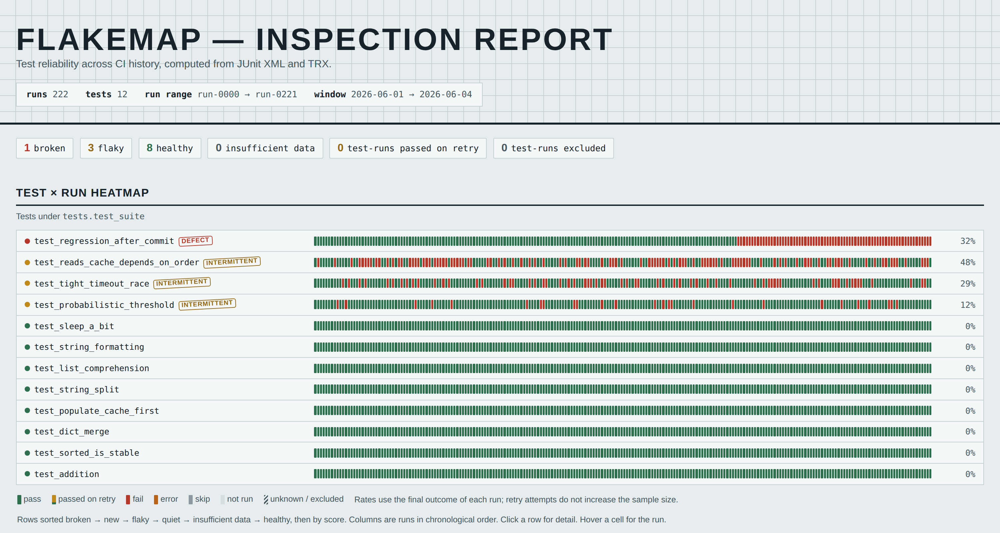
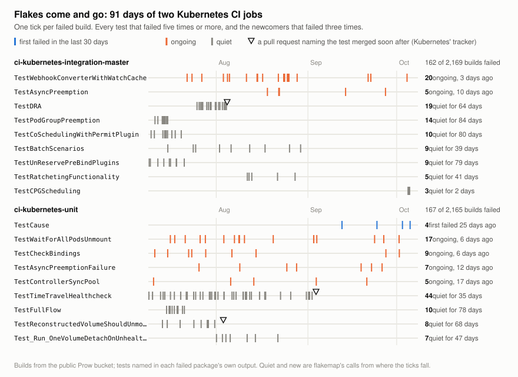
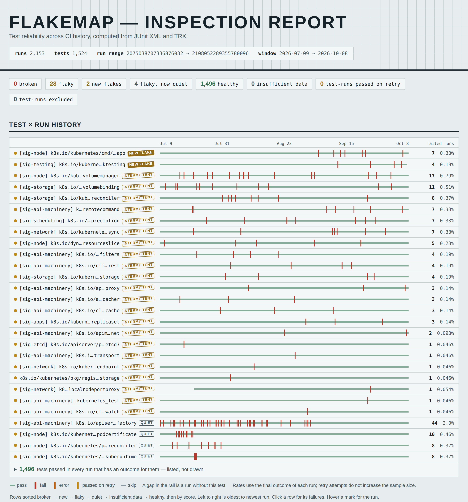
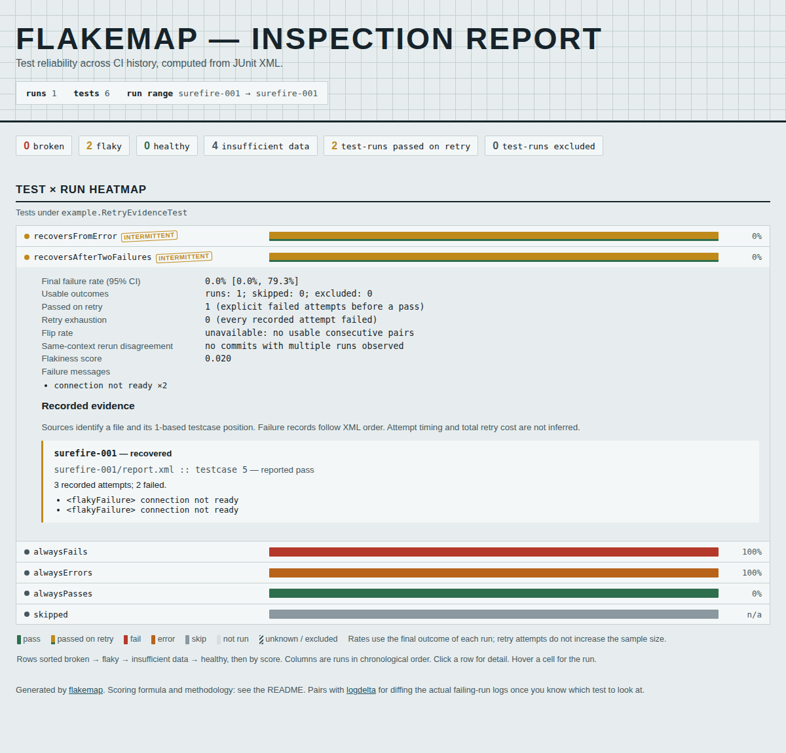
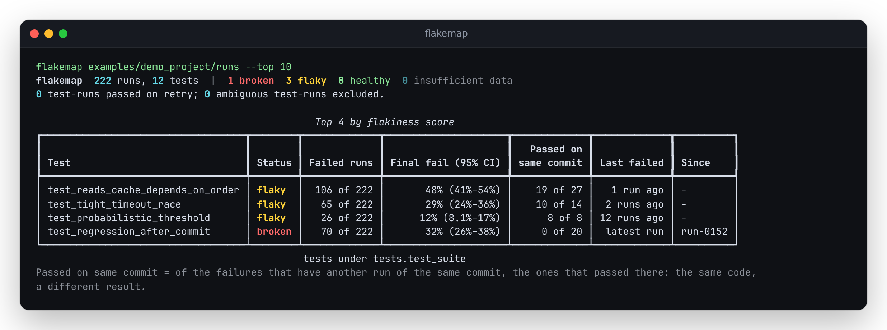

# flakemap

**Find the failures that green retries hide. Inspect JUnit history locally, down
to the failed attempts and source records.**

[](https://pypi.org/project/flakemap/)
[](LICENSE)
[](https://antonsoo.github.io/flakemap/)
[](https://huggingface.co/spaces/antonsoloviev/flakemap)

CI can turn green after a test fails twice and passes on its third attempt.
Surefire preserves those failures as `<flakyFailure>` records, but a reader that
only looks for `<failure>` sees an ordinary pass. Flakemap keeps the failed
attempts, distinguishes retry recovery from final failure rate, and lets you
inspect the source file and testcase behind each finding.

Give it one report to inspect retries, or a history of reports to rank intermittent
failures, compare runners, and look for regressions. Duplicate identifiers and
conflicting shard metadata stay visibly excluded instead of becoming extra
statistical samples. Reports are local, self-contained files, with no CI-provider
account or service required. It pairs with the same author's
[`logdelta`](https://github.com/antonsoo/logdelta) (diff logs from a failing CI
run against known-good baselines) once you know *which* test to look at.

The source checkout also honors **GoogleTest's explicit non-execution markers**.
In the [compiled reproduction](examples/googletest_project/README.md), one real
failure followed by seven disabled runs previously became seven passes and a
12.5% failure rate. It now remains one failed execution, seven skips and
insufficient data. These are source updates; no PyPI release is part of this verification.

**Well-formed XML can still hide missing results.** The source checkout now
checks JUnit summary totals against retained testcase records and explicit
retry attempts. Removing failing testcases or their outcome markers previously
passed `--fail-on-incomplete`; those counter mismatches now exit 2. Original
Surefire retry totals and GoogleTest disabled-test controls still reconcile.
[Captured reports, before/after replay and limits](studies/junit-counters/README.md).
This correction preserves observed test outcomes; source publication is separate
from a PyPI release.
The same protection now covers [TRX primary counters](studies/trx-counters/README.md),
including nested data rows, while preserving VSTest's skipped-test convention.
Counter agreement alone does not establish a consistent hierarchy: the actual
VSTest logger can emit a passed parent containing a failed row. The source
checkout now retains that child evidence, excludes the contradictory parent as
unknown and exits 2 with `--fail-on-incomplete`.
[Native logger controls and scope](studies/trx-hierarchy/README.md).

Native NUnit generic fixtures also keep their complete type arguments. The old
reader merged `Pair<Int32,String>` and `Pair<Int32,Double>` into a 50% flaky
history; the compiled capture instead has one fixture passing all six executions
and one failing all six. [Native records and before/after reports](studies/trx-generics/README.md).
This source correction is separate from the PyPI release.

<p align="center"></p>

## On a real history: 91 days of Kubernetes CI

Kubernetes publishes every build of its CI jobs. [A study in this repository](studies/kubernetes-ci/README.md)
reads three months of two of them, 4,334 hourly builds of `master`, and runs
flakemap over the JUnit reports.

- **One build in thirteen failed, and nearly every failure that could be checked
  passed on the same commit.** Of 314 package failures on a commit that was built
  more than once, 310 passed in another build of it. None was a test that broke
  and stayed broken. That rules out the commit, not the machine.
- **A rate hides when.** Sixteen tests failed five times or more; for ten of
  them the failures sit in a stretch that ended weeks before the window did.
  `TestDRA` failed 19 times between 25 July and 4 August and not once in the
  1,538 builds after.
- **Kubernetes' own tracker has a fix at the right moment for three of the
  ten**: a pull request naming the test merged within three days of the last
  failure flakemap saw. For the others it has a revert that landed after the
  failures had stopped, a closed issue, nothing, or an issue still open.
- **The first answer to "when" was a probability, and it did not survive
  review.** It assumed independent failures while showing that they come in
  bursts. Quiet and new are now a rule to check on the timeline, with no odds.
- **The released flakemap could show none of this**: its report of one of the
  two histories was a 687 MB HTML file, every failure message the word
  "Failed". What that changed is below and in the study.

<picture>
  <source media="(prefers-color-scheme: dark)" srcset="studies/kubernetes-ci/figures/timeline-dark.svg">
  
</picture>

```console
$ uv run python studies/kubernetes-ci/collect.py      # fetch the builds (1.4 GB)
$ uv run flakemap studies/kubernetes-ci/cache/ci-kubernetes-integration-master --top 4
```

<p align="center"></p>

The other job's history as a page: 1,524 Go packages over 2,153 builds. A rail
per package that ever failed, a mark per failure, each failure's evidence one
click away, and 0.4 MB where the released version wrote 687.

<p align="center"></p>

## What a green result can hide

```bash
uv run flakemap examples/retry_history --html retry-report.html
uv run flakemap examples/retry_history --json --fail-on-retry > retry-report.json
```

The second command writes valid JSON and exits **1**: two tests in this fixture
passed only after failures. The fixture was produced by **Maven Surefire 3.5.4**
running the [included Java tests](examples/retry_project/README.md), with controlled
failures. It is not evidence about a production project's reliability.

| Test | Reporter evidence | Final outcome | Counted toward rate |
|---|---|---|---|
| `recoversAfterTwoFailures` | 2 failed attempts, then a pass | pass, flagged flaky | 1 run |
| `recoversFromError` | 1 error, then a pass | pass, flagged flaky | 1 run |
| `alwaysFails` | failure plus 2 failed retries | fail | 1 run |
| `alwaysErrors` | error plus 2 errored retries | error | 1 run |

The XML's suite counter says **13 tests**; there are **6 testcases**, including
an ordinary pass and a skip. Attempt totals do not become sample sizes. One
reported recovery is direct evidence of a passed-on-retry result, but one run
cannot estimate its long-term frequency precisely. The exhausted cases therefore
remain `insufficient_data`, rather than being labeled permanently broken.



Retry inspection is in the CLI and in every generated HTML report. The hosted
gallery includes the [captured Surefire retry report](https://antonsoo.github.io/flakemap/retry.html),
alongside the original pytest history and its other examples.

## When several failures belong to the same investigation

The source checkout also groups tests with identical outcome histories. In the
[controlled HTTP capture](examples/cofailure_project/README.md), inventory,
pricing and shipping tests all fail on runs 04, 05 and 10. An independent math
failure and an endpoint test with missing coverage stay separate.

```bash
uv run flakemap examples/cofailure_history --html shared.html --json > shared.json
```

Open **Tests that fail together** for run IDs, original statuses, source positions
and messages. Download every group's evidence from the offline report or follow
a member link to its individual statistics. Skips, missing results, retries and
ambiguous records cannot silently become matching passes. Shared history is an
investigation lead, not proof of a common cause. [Rules and limits](docs/shared-outcomes.md).

`uv run python scripts/build_demo_site.py` builds a local example gallery under
`site/`, including shared outages, Surefire retries and interrupted input alongside
the original long-history report. Each example states its provenance.

## Quickstart

```console
$ git clone https://github.com/antonsoo/flakemap && cd flakemap
$ uv sync
$ uv run flakemap examples/demo_project/runs
```

That last command analyzes the ~220 real `pytest` runs committed in this repo
(see [The planted demo](#the-planted-demo-a-history-with-known-answers)) and prints the terminal
report below -- no setup, no fixtures to write yourself. To use it on your own
reports, install it from PyPI: `pip install flakemap`, or run it without
installing: `uvx flakemap path/to/reports`.

The source corrections described above are not in the tested PyPI 0.3.7 build.
To use them on your own reports, install this verified public revision:

```bash
python -m pip install --force-reinstall "flakemap @ git+https://github.com/antonsoo/flakemap.git@401dc15d86c91f8ff1f7cdb9e8961f6eb800bd81"
```

`--force-reinstall` replaces an existing 0.3.7 installation; this source still
declares that version. The [generic fixture study](studies/trx-generics/README.md) retains the current
correction and its installed-artifact checks; the [native hierarchy study](studies/trx-hierarchy/README.md)
retains the earlier parent/child correction.
The [earlier installation and gate replay](studies/gate-window/results/source-install.json)
records the preceding recent-build correction. A source installation is separate
from a new PyPI release.

## Features

- **JUnit XML parsing**: pytest, Jest (jest-junit), and Maven Surefire checked
  against real tool output; Gradle merged retries and go-junit-report supported
  against their documented formats.
- **.NET TRX**: `dotnet test --logger trx` output (MSTest, xUnit, NUnit), checked
  against twelve real MSTest runs in `examples/trx_history`. Top-level results
  stay separate tests; nested rows remain evidence of their parent. Each file's
  own start time orders the runs. Malformed and truncated files
  degrade to a warning, never a crash. Details and sources:
  [`docs/formats.md`](docs/formats.md).
- **Retry evidence**: explicit recovered and exhausted attempts, source file and
  testcase positions, failure messages, and a separate recovered-run count.
  Retries never inflate the per-run failure-rate denominator.
- **Input integrity**: duplicate test identifiers and inconsistent run metadata
  are excluded with inspectable records. Warnings survive JSON, Markdown, and
  HTML export. `--fail-on-incomplete` makes these omissions fail a CI check.
- **Shared outcomes** (source checkout): exact matching failure/retry histories
  with member links, run metadata, source records and complete offline JSON
  downloads. Missing, skipped and ambiguous observations retain their meaning.
- **Run metadata** (commit, branch, timestamp, runner, OS) from a sidecar
  JSON, a directory-per-run layout, or file mtime as a last resort.
  Shard merges preserve timestamp provenance independently of sequence values;
  [renaming the files cannot invent a timestamp conflict](studies/shard-timestamps/README.md)
  in the source checkout.
  Sidecar timestamps require an explicit UTC offset in this checkout: treating
  local clocks as UTC can [turn an old failure burst into a new-flake alert](studies/sidecar-timezones/README.md).
  Invalid times warn; valid sequences or report timestamps can still establish order.
  A sequence-only sidecar also retains the report's own timestamp in this checkout;
  [contradictory sequences cannot turn old failures into a new-flake alert](studies/report-sequences/README.md).
- **Per-test statistics**: Wilson-interval failure rate, flip rate,
  same-commit rerun disagreement (the "failed then passed on identical code"
  signal), a documented flakiness score, single change-point detection,
  duration trend, duration-vs-failure correlation, and per-runner/per-OS
  failure rate breakdowns.
- **Evidence per failure** (source checkout): what the other runs of the same
  commit did (passed, failed, or there were none) and how many other tests
  failed in that run.
- **New, ongoing or quiet** (source checkout): whether a flaky test's failures
  are still arriving, from where they fall in the history. A rule you can
  check by eye: the longest quiet spell between failures, and how many times
  longer the current silence is.
- **Go reports that keep one record per package** (source checkout): the tests
  a failure's own output names (`--- FAIL:` lines) are counted and placed
  separately, and gotestsum's constant "Failed" is replaced by the failing
  test's last log line.
- **Long histories** (source checkout): past 300 runs the HTML report draws a
  rail and a mark per failure instead of a cell per run, and lists tests that
  never failed instead of drawing them. 2,000 runs of 1,500 tests is a 0.4 MB
  page.
- **Classification**: `broken` (consistently failing since a commit) vs.
  `flaky` (intermittent) vs. `healthy` vs. `insufficient_data`, plus grouping
  by suite/module.
- **Outputs**: a rich terminal report, `--json`, `--markdown` for PR comments,
  and a self-contained `--html` report with a test x run heatmap, per-test
  detail, and failure-message clustering.
- **`--fail-on-new-flake`** for CI gating: exit 1 if a flaky or broken test began
  failing inside a trailing window: a change point there or, in a source
  checkout, failures that start there after a clean stretch three times the
  longest gap between them, or a test named in a failure's output (Go
  `--- FAIL:` lines) that first failed there and failed more than once.
  This checkout counts the window over every supplied build, including skipped
  and absent tests; [retiring a test cannot keep an old failure inside the window](studies/gate-window/README.md).
- **`--fail-on-retry`** exits 1 for any explicitly recovered test in the supplied
  history, including a single run. Pass only the current run when gating a build.

## Usage

```console
$ flakemap examples/demo_project/runs --top 10
```

<p align="center"></p>

```console
$ flakemap examples/demo_project/runs --json | jq '.tests[0]'
$ flakemap examples/demo_project/runs --markdown > flake-report.md   # for a PR comment
$ flakemap examples/demo_project/runs --html report.html            # self-contained, open in a browser
$ flakemap examples/demo_project/runs --fail-on-new-flake; echo "exit: $?"
```

The source checkout preserves imported test names, run IDs and warnings as
literal text in Markdown reports. Previously, parameter IDs such as
`` became images even inside HTML `<code>` wrappers.
[Actual pytest captures and reference-rendered before/after reports](studies/markdown-literals/README.md)
verify the correction. This is a source update, pending a package release.

Click any row in the HTML report to expand its full statistics (see
[`docs/assets/heatmap-detail.png`](docs/assets/heatmap-detail.png) for a
worked example); hover a cell for that run's id, commit, duration, and failure
message. A history longer than 300 runs is drawn as a rail per test with a mark
per failure, and the opened row lists its failures. It respects `prefers-color-scheme` for dark mode and has zero
external requests -- open it from a CI artifact zip with no network.

## How it works

Full formulas and citations are in the module docstrings
(`src/flakemap/stats/`); this is the summary.

- **Final failure rate**: `fails / (pass + fail + error)`, one outcome per test
  per run. Skips, ambiguous duplicates, and contradictory outcomes are excluded.
  A passed-on-retry test remains a final pass, with its recovery counted separately.
  The rate is reported with a **Wilson score interval**
  (Wilson, E.B., 1927, *"Probable Inference, the Law of Succession, and
  Statistical Inference,"* JASA 22(158):209-212) rather than a plain Wald
  interval, because Wald intervals can extend past [0, 1] and have poor
  coverage exactly where most tests live: small samples, rates near 0 or 1.
- **Flip rate**: the fraction of consecutive observed, non-skipped outcome pairs
  that changed (pass -> fail or fail -> pass). Unknown outcomes break pairs;
  absent tests and skips are not observations. `flip_pairs` gives the denominator.
- **Same-context rerun disagreement**: group by commit, branch, runner and OS.
  Released versions report the fraction of groups with 2+ runs that hold both a
  pass and a failure. The source checkout reports the chance that two runs of
  the same commit disagree: within a commit run `m` times with `f` failures,
  `f(m - f)` of its `m(m - 1)/2` pairs of runs disagree, and commits are
  weighted by their runs. With two runs per commit the two definitions give the
  same number; with commits built from twice to a hundred times, the first made
  a test's score depend on which commits its failures happened to land on.
  Grouping by runner and OS avoids treating a Linux pass and a Windows failure
  as a rerun on the same environment. Unrecorded configuration can still differ
  (cf. Lam et al.,
  *"iDFlakies: A Framework for Detecting and Partially Classifying Flaky
  Tests,"* ICST 2019, which uses repeated execution on a fixed revision as the
  ground-truth signal for flakiness).
- **Evidence per failure** (source checkout): each failure is compared with the
  other runs of its commit in the same context. **Passed** in at least one of
  them: the same code gave both results, which is what flaky means. **Failed**
  in all of them: consistent with a real break, or a flake that struck twice.
  **No other run**: nothing to compare. Reports show the counts ("19 of 19
  passed on the same commit") and, in HTML and JSON, the verdict for every
  failure.
- **New, ongoing, quiet** (source checkout): one failure rate for a whole
  history assumes the test failed at that rate throughout. Activity counts
  runs with observed failures, including explicit failed attempts before a retry
  passes. Final pass/fail rates remain separate. Consecutive affected
  runs count as one event; `longest_gap` is the most runs without an observed failure between two
  successive events. A test is **quiet** when it has at least 3 events and the
  runs since its last failure are at least 3 times `longest_gap` and at least
  10: it has now been quiet three times longer than it ever was between
  failures. A flake that comes in bursts has its long gaps on record and needs
  a longer silence; one burst followed by a long silence is quiet, which says
  the burst is over, not that it cannot come back. **New** is the mirror image
  (the clean stretch before the first failure), and only for a test whose
  passing runs the history records; a Go test named in a failure's text may
  have been added the day it first failed, so it gets "first failed N runs
  ago" and no label. Everything else is **ongoing**. For a steady flake
  (independent runs, constant rate) the chance that the open silence is at
  least `s` times the longest of `n` earlier gaps is
  `n! / ((s+1)(s+2)...(s+n))`: at s = 3, 10% with 2 gaps, 5% with 3, under 1%
  from 7. That is a statement about steady flakes only; no probability is
  claimed for bursty ones, and none is printed.
  (`src/flakemap/stats/activity.py`)
  A [Surefire-based replay](studies/retry-activity/README.md) previously called
  15 consecutive passed-on-retry runs "quiet". It now reports continuing activity;
  newly recurring retries can trip `--fail-on-new-flake`. An ambiguous outcome
  leaves activity unavailable and makes that gate return 2.
- **Flakiness score** (0-1, a heuristic, not a literature standard):
  `confidence * (0.4 * flip_rate + 0.4 * max(rerun_signal, recovered_runs/n) + 0.2 * intermittency)`,
  where `intermittency = 2 * min(p, 1-p)` (0 when always-pass or always-fail,
  1 at p=0.5) and `confidence = min(1, n/20)` shrinks the score for
  small samples to reduce their influence on the ranking.
  Recovery is based only on explicit retry markers; its observed frequency is
  not an estimate of unreported retries. No retry markers means no change to
  the previous score formula.
- **Change point**: a single-change-point likelihood-ratio detector for a
  Bernoulli sequence (see Chen, J. & Gupta, A.K., *Parametric Statistical
  Change Point Analysis*, 2nd ed., Birkhauser, 2012, ch. 3) -- the split that
  best explains the run history as two constant-rate segments instead of one,
  subject to a minimum segment length (3), a minimum rate shift (0.2), and a
  significance threshold on the likelihood-ratio statistic (13.8). Scanning
  every split always finds a best one, even in a test that has failed at the
  same rate all along; the threshold is the statistic's approximate 99th
  percentile under no change, from simulation over 50-1000 runs and 5-50%
  failure rates (`scripts/changepoint_null.py` prints the table). A steadily
  flaky test now reports a change about 1% of the time, where before the
  threshold it was up to half the time, and one in its last 10 runs 12-16% of
  the time (the window `--fail-on-new-flake` gates on). The price is
  sensitivity to small, recent shifts: a test going from 0% to 20% failures
  in its last 10 runs is caught about half the time. The selected split is
  not proof of the cause or onset. A flake that fails one run in fifty never
  shifts the rate by 20 points, so it never has a change point; in the source
  checkout `--fail-on-new-flake` also fires for a test labelled **new** whose
  first failure is inside the window (three failures after a clean stretch of
  at least 3 times their longest gap), and for a test named in a failure's
  output that first failed inside the window and failed more than once. Widen
  `--new-flake-window` to match how often your flakes fail.
- **Duration signals**: an OLS trend (seconds per supplied history run) and the
  **point-biserial correlation** between duration and outcome (Tate, R.F.,
  1954, *"Correlation Between a Discrete and a Continuous Variable,"* Annals
  of Mathematical Statistics 25(3):603-607) -- the signature of a
  timeout-driven flake is a positive correlation (failures ran longer).
  Retry-bearing records are excluded: Surefire's `time` describes a single
  attempt, not the retry cost. Missing/invalid durations stay unknown. The trend
  retains the original run positions: 10 seconds at run 0 and 30 seconds at run
  10 means +2 seconds/run, even if all intervening timings are missing. Reports
  show the number of usable timing observations.
- **Runner/OS correlation**: per-category Wilson intervals rather than a
  chi-square p-value. With the handful of runners and modest per-category
  sample sizes typical of a CI matrix, a hypothesis test would overstate
  precision; a report should show the spread and let a non-overlapping
  interval speak for itself.
- **Classification**: an explicit recovered retry is labeled `flaky`, even from
  one run. Otherwise (`src/flakemap/stats/analyze.py::_classify`), fewer than
  5 observations -> `insufficient_data`. Zero failures and zero flips ->
  `healthy`. A significant change point with a post-change failure rate >= 75%
  (and no rerun disagreement) -> `broken`; this comes before the flip rate,
  because in a short history the one pass-to-fail switch of a regression is
  itself a flip rate over 8%. Flip rate > 8% or any rerun disagreement ->
  `flaky`. An overall failure rate >= 60% -> `broken`. Any remaining failures
  -> `flaky`. In the source checkout only a rerun disagreement *since* the
  change point rules out `broken`: over months most tests flake once, and that
  kept a test that then failed every run from ever being called broken. These
  thresholds are documented, not tuned against a labeled corpus -- treat them
  as a reasonable default, not a calibrated model. On the Kubernetes histories
  every package that ever failed is `flaky`, which the same-commit evidence
  bears out for 310 of the 314 failures it can check.
  Excluded outcomes prevent a `healthy` label and suppress change-point inference
  for that test. The confidence interval measures final-failure frequency, not
  confidence in the classification or a claim about the cause.

## The planted demo: a history with known answers

`examples/demo_project/` is a small synthetic `pytest` suite
(`tests/test_suite.py`) with **planted, documented** failure patterns: a
timing race against a tight budget, `random()`-driven flakiness, a
shared-mutable-state test that's order-dependent under `pytest-randomly`, a
handful of always-passing tests, and one test that reliably regresses from a
specific simulated commit onward (`BUG_INTRODUCED_AT = 130`).
`generate_demo_data.py` runs that real suite 222 times (190 simulated commits,
32 with a same-commit rerun) with `pytest-randomly` reshuffling test order and
reseeding `random` every run, tags roughly a quarter of runs as a slower
`macos-latest` runner (a scripted constant delay added to real, measured
sleeps -- see the script's docstring), and writes each run's real
`pytest --junitxml` output plus a `meta.json` sidecar. The committed
`examples/demo_project/runs/` (~2.7 MB across 222 run directories, every file
well under 1 MB) is that exact output; regenerate it yourself with
`uv run python examples/demo_project/generate_demo_data.py`.

Nothing about the *outcomes* is scripted -- every pass/fail in the XML is a
real `pytest` result. Running `flakemap` on that corpus recovers the planted
ground truth:

| Test | Planted as | flakemap says |
|---|---|---|
| `test_regression_after_commit` | breaks forever at commit 130 | **broken**, change point at commit `00082aaaaaaa` (hex `82` = 130) -- exact match |
| `test_reads_cache_depends_on_order` | order-dependent (~coin flip under shuffling) | **flaky**, 47.8% failure rate, 48.0% flip rate |
| `test_tight_timeout_race` | timing race, `macos-latest` slower | **flaky**, 29.3% overall; 51.1% on `macos-latest` vs. 23.4% on `ubuntu-latest` (non-overlapping 95% CIs); duration-failure correlation +0.79 |
| `test_probabilistic_threshold` | `random() >= 0.12`, i.e. ~12% | **flaky**, 11.7% measured (Wilson 95% CI 8.1-16.6%, contains the planted 12%) |
| 8 deterministic tests | always pass | **healthy**, 0% failure rate on all 8 |

Reproduce this table: `uv run flakemap examples/demo_project/runs --json`.

## Accuracy and limitations

- **Change points are calibrated approximately, not exactly.** The
  significance threshold is one fixed value from simulation, so the
  false-positive rate on a constant-rate test varies from about 0% to 2% with
  history length and failure rate, and short histories are held to a stricter
  standard than they need. Both the "since" run and the classification are
  triage hints, not causal conclusions.
- **Format coverage is explicit.** The original basic Go/Surefire fixtures were
  hand-authored. Retry support now also has real Surefire output; Gradle's merged
  retry convention is checked against documentation, not a local Gradle run. See
  [`docs/formats.md`](docs/formats.md) for exactly what was and wasn't
  verified against real tool output.
- **Unmerged retries are ambiguous.** Repeated `<testcase>` identifiers can also
  mean parameter collisions or copied artifacts. Flakemap excludes them instead
  of assuming order or counting them as independent runs. For Gradle, enable
  `mergeReruns`; for CI job reruns or matrix variants, supply distinct `run_id`s.
- **Reports can omit retry history.** A clean-looking record proves only that
  no supported retry markers were present. No attempt times or causal diagnosis
  are reconstructed. Failure messages are limited to their first 500-character
  line; source pointers refer to testcase ordinals, not line numbers.
- **Temporal conclusions need a common chronology.** In this source checkout,
  provide distinct sequences for all runs, or distinct recorded timestamps for
  all runs. Supplied sequences and timestamps must agree. File copy times and
  lexical run IDs only order the display: incomplete, tied or contradictory
  ordering leaves activity, onset, flip rate, latest outcome and duration trend
  unavailable. Counts, retries and same-commit comparisons remain usable; the
  heuristic score omits its flip component. `--fail-on-new-flake` returns 2 when
  chronology is unavailable. A decrease in the final failure rate is not a new flake. See the
  [retained pytest counterexample](studies/ordering-evidence/README.md) and
  [ordering contract](docs/formats.md#run-ordering-in-the-source-checkout).
  This is unreleased source behavior; JSON output is version 3.
- **New and quiet are about placement, not cause.** "Quiet" says the failures
  stopped; a fix, a revert, a deleted test and a renamed one look alike. It is a
  rule, not a significance test: bursts make long silences less surprising, which
  is why the silence is measured against the test's own longest gap. A test needs
  three separate failures before it can be labelled, and "new" cannot tell a
  newly added test from a newly flaky one when a test appears in the history
  only once it exists.
- **Names from failure output are Go's convention.** `--- FAIL:` lines are what
  `go test` prints. A report that rolls tests up in another ecosystem gets its
  package-level statistics and nothing finer.
- **Message clustering is a digit-normalization heuristic**
  (`\d+` -> `#`), not semantic diffing -- it merges "timed out after 4123ms"
  variants but won't merge two differently-worded messages for the same root
  cause. For a Go failure whose message is gotestsum's "Failed", the source
  checkout clusters on the last line the failing test logged from its own
  `_test.go` file, which is usually the assertion and sometimes is not. That's closer to what [`logdelta`](https://github.com/antonsoo/logdelta)
  does on the actual log content once you know which run to inspect.
- **The flakiness score and classification thresholds are a documented
  heuristic**, not fit against a labeled corpus. They're a reasonable default
  starting point for ranking, not a calibrated flakiness probability. At real
  flake rates the score is a small number (0.02 for a test failing one run in
  a hundred), so tables show failed runs and rates and keep the score for
  ordering.
- **This is an offline batch tool.** It doesn't talk to any CI provider's
  API; you still need a step that collects JUnit XML as artifacts (see the CI
  recipe below).

## CI recipe (example)

A weekly job that pulls the last N runs' JUnit XML artifacts and gates on new
flakes. Adjust the artifact-collection step to your CI provider; this is
GitHub Actions collecting `pytest --junitxml` output into a rolling directory
of run artifacts, then running flakemap against it:

```yaml
# .github/workflows/flakemap-weekly.yml (example -- adapt to your own artifact storage)
name: flakemap weekly
on:
  schedule:
    - cron: "0 6 * * 1"
  workflow_dispatch:
jobs:
  flake-report:
    runs-on: ubuntu-latest
    steps:
      - uses: actions/checkout@v7
      - uses: astral-sh/setup-uv@v10
        with: { python-version: "3.12" }
      # download-artifact (or your artifact store) into ci-runs/<run_id>/report.xml
      # each with a meta.json sidecar -- see docs/formats.md's convention.
      - run: uvx flakemap ci-runs/ --markdown >> "$GITHUB_STEP_SUMMARY"
      - run: uvx flakemap ci-runs/ --fail-on-new-flake --fail-on-incomplete
```

Use `--fail-on-retry` on a current-run artifact to gate on observed retry recovery.
Exit codes: **0** report completed with no requested gate hit; **1** a requested
flake/retry gate hit; **2** an input/output error, no usable outcomes, or an
incomplete report with `--fail-on-incomplete`. Code 2 takes precedence. Diagnostics
go to stderr, so `--json --html report.html --fail-on-retry` still emits one valid
JSON document on stdout. [JSON schema version 2](docs/formats.md#json-output-version-2)
includes retry and excluded-record evidence.

`--new-flake-window` counts all supplied runs after the inferred onset, including
runs where that test is absent or skipped. It does not keep an old change
"new" because the test disappeared. `summary.input_complete` in JSON reflects
detected input/ordering warnings. HTML writes preserve the previous report on
failure and refuse to overwrite source reports or metadata.

Try [the incomplete-history walkthrough](examples/incomplete_history/README.md)
for a small, explicitly synthetic example of a killed JUnit run and TRX outcomes
that do not establish pass or failure. [Parser limits and encoding support](docs/formats.md#text-decoding-and-limits)
describe what can be recovered and what remains unknown.

## Contributing

See [`CONTRIBUTING.md`](CONTRIBUTING.md). Tests, lint (`ruff`), format
(`ruff format`), and typecheck (`mypy --strict`) all run via `uv run`; no
network access is needed beyond `uv sync`.

## License

[MIT](LICENSE) (c) 2026 Anton Soloviev.

---

<sub>Part of [Officina](https://antonsoo.github.io/officina/), a set of small open-source tools by [Anton Soloviev](https://github.com/antonsoo).</sub>
