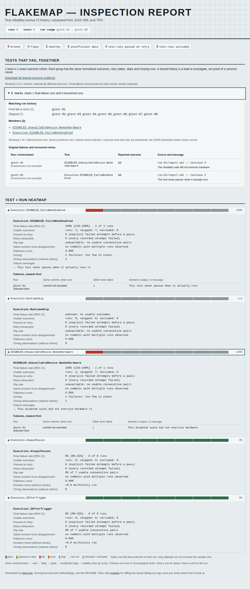

# A disabled test is not a passing test

This controlled C++ program reproduces a reader error using **GoogleTest 1.17.0**.
One test and one suite have `DISABLED_` names. They fail whenever they actually
execute. The first captured run enables them with
`--gtest_also_run_disabled_tests`; seven later runs use normal execution, which
suppresses them. An ordinary pass and a runtime skip provide controls. A
separate fail-fast capture records a test skipped after another test fails.

These are deliberate outcomes for checking a report reader, not measurements
of a production project's reliability. The XML and stdout are unedited runner
output. Sidecars supply a controlled sequence, because GoogleTest's local
timestamps have no UTC offset. The capture script adds no invented commits,
runner identities or wall-clock ordering.

## What changed

GoogleTest records suppressed tests using `status="notrun" result="suppressed"`
without a `<skipped>` child. Flakemap used to see the absence of `<failure>` and
count a pass. The [versioned emitter](https://github.com/google/googletest/blob/v1.17.0/googletest/src/gtest.cc)
and [GoogleTest's execution documentation](https://google.github.io/googletest/advanced.html#temporarily-disabling-tests)
define the distinction. An explicit disabled name alone is insufficient: the
first run actually executes those same named tests.

| `Execution.DISABLED_FailsWhenEnabled` | Baseline `df8937f` | Current reader |
| --- | --- | --- |
| Successful executions counted | 7 | 0 |
| Failed executions counted | 1 | 1 |
| Non-executed observations | 0 | 7 skips |
| Failure-rate denominator | 8 | 1 |
| Observed failure fraction | 12.5% | 100% of one execution |
| Classification | flaky | insufficient data |
| Timing observations | 8, including suppressed zeroes | 1 |

The 100% fraction does not establish a permanently broken test: there is only
one execution, with a wide interval. Seven suppressed tests provide no evidence
of recovery. The disabled suite's `NeedsHardware` case has the same correction.

[Before JSON](../../docs/evidence/googletest/before.json),
[after JSON](../../docs/evidence/googletest/after.json), and the
[standalone HTML report](../../docs/evidence/googletest/after.html) retain the
comparison. The [capture manifest](captures/capture.json) records the runner
flags, expected exit codes and XML hashes. The source archive SHA-256 is pinned
below; the source code itself is not vendored.



## Inspect the retained history

From an installed source checkout:

```sh
uv run flakemap examples/googletest_history --html googletest-report.html --json > googletest-report.json
uv run flakemap examples/googletest_history --fail-on-incomplete
```

The integrity gate exits zero because the reports are readable and unambiguous.
That is not an assertion that all tests ran or passed. Unknown or contradictory
execution attributes instead produce excluded observations and make
`--fail-on-incomplete` exit 2.

## Reproduce the runner output

Run these commands from the repository root with `curl`, `tar`, `g++` (C++17)
and `uv`. The captured build used GCC 13.3.0 on Linux. Everything below is local;
the GoogleTest source is downloaded from its official release tag.

```sh
gtest_build=scratch/googletest-build
mkdir -p "$gtest_build"
curl --fail --location https://github.com/google/googletest/archive/refs/tags/v1.17.0.tar.gz -o "$gtest_build/googletest.tar.gz"
printf '%s  %s\n' 65fab701d9829d38cb77c14acdc431d2108bfdbf8979e40eb8ae567edf10b27c "$gtest_build/googletest.tar.gz" | sha256sum --check
tar -xzf "$gtest_build/googletest.tar.gz" -C "$gtest_build"
g++ -std=c++17 -pthread \
  -ffile-prefix-map="$gtest_build/googletest-1.17.0"=googletest-v1.17.0 \
  -I "$gtest_build/googletest-1.17.0/googletest/include" \
  -I "$gtest_build/googletest-1.17.0/googletest" \
  examples/googletest_project/nonexecution_test.cc \
  "$gtest_build/googletest-1.17.0/googletest/src/gtest-all.cc" \
  "$gtest_build/googletest-1.17.0/googletest/src/gtest_main.cc" \
  -o "$gtest_build/nonexecution-test"
uv run python examples/googletest_project/capture.py "$gtest_build/nonexecution-test" \
  --output scratch/googletest-history --controls scratch/googletest-controls
uv run flakemap scratch/googletest-history --json
```

The prefix-map option prevents machine-specific build paths from entering
GoogleTest's stdout. Regenerated XML timestamps will differ, but the test names,
execution attributes and outcomes should match. The history contains eight
real invocations of this controlled program, rather than copied XML files.

## Scope

The reader recognizes GoogleTest's `run`/`notrun` status and
`completed`/`skipped`/`suppressed` result vocabulary, alongside ordinary JUnit
child markers. `completed` permits either a pass or an explicit failure; it is
not a success flag. Unsupported values and conflicting skip/failure/retry
evidence remain unknown. Attributes and names alone do not prove a report's
producer was truthful.

Feed execution reports, not `--gtest_list_tests` inventories: an inventory can
omit all execution attributes, making its empty testcase indistinguishable
from a minimal JUnit pass. This fix does not infer execution from an inventory.
No other GoogleTest version or C++ test framework was run for this capture.

## Clean-checkout verification

A fresh detached checkout of `109cbb5` was verified on 2026-10-09 using
Python 3.12.12, GCC 13.3.0 and Node 26.7.0. The reproduction commands above
downloaded the pinned archive, compiled the C++ source and captured nine new
invocations. The new history agreed with the retained history on outcomes,
failure rates, classifications and activity. The fail-fast execution markers
also matched. Timestamps and measured durations are not expected to be identical.

| Check | Result |
| --- | --- |
| `uv sync --locked`; Ruff lint and format checks; `uv run mypy` | Passed; 27 source files typechecked |
| `uv run pytest -q` | 307 passed |
| `uv build` | Source archive and wheel built |
| Wheel installed into a separate fresh environment | JSON matched the retained analysis; HTML matched byte for byte |
| Unsupported and contradictory marker controls through the installed CLI | Exit 2; excluded outcomes, no failure-rate denominator |
| Existing CLI examples: demo, retry, shared failures, JSON, Markdown, HTML and gates | Nine workflows passed with their expected exit codes |
| `uv run python scripts/build_demo_site.py` | Five static report pages under `site/` |
| Fresh npm install, report fixture generation and `node scripts/check_report.mjs` | 104 offline scenarios passed in Chromium 153 and Firefox 155, at 320/1200 px in both themes |

The installed-wheel results are retained in
[installed-results.json](../../docs/evidence/googletest/installed-results.json).
The demo's existing `--fail-on-new-flake` example exits 0; the retry fixture's
`--fail-on-retry` exits 1. Neither outcome is an assertion that every test passed.

The browser workflow uses real standalone files, without a server:

```sh
npm ci
uv run python scripts/browser_fixtures.py
node scripts/check_report.mjs
```

The [browser results](../../docs/evidence/googletest/browser-results.json) retain
the engine versions, report hashes and each scenario's outcome. All scenarios
had zero page errors, external requests, CSP violations and automated
accessibility violations. Eight scenarios exercised the GoogleTest report's
actual skip cells, keyboard expansion, one-execution denominator and timing count.

The [desktop screenshot](../../docs/assets/googletest-execution.png) and the
320 px dark-mode report were visually inspected. The existing inspection-report
layout remains intact; disabled observations are gray, and the expanded detail
shows the actual one-execution denominator and useful failure message. Wide
source-evidence tables scroll within their own region on narrow screens.

These changes are local and unreleased. No package or hosted report was published.
