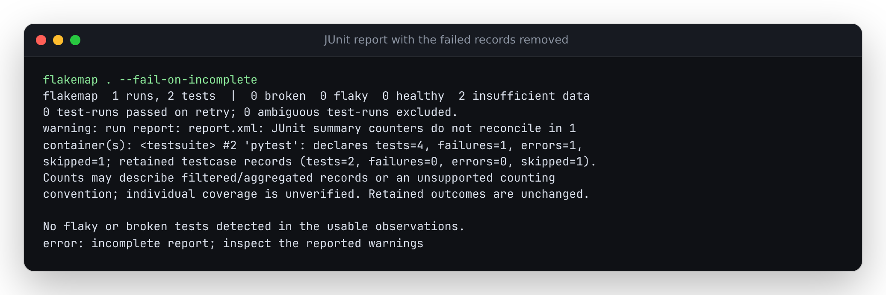

# When well-formed JUnit XML loses the failing records

At revision `8542d33`, removing both failing/error testcases from a real
four-record pytest report left a pass and a skip, while its counters still said
four tests, one failure and one error. Flakemap reported `input_complete: true`
and `--fail-on-incomplete` exited 0. Removing only the outcome markers also
passed: the record count alone cannot detect that loss.

The source fix reconciles suite and parent-container counters with retained
testcases or explicit retry attempts. The same inputs now produce coverage
warnings and exit 2. Recorded outcomes and their statistical denominators stay
unchanged. These changes are local source work, not a PyPI release or deployment.



## Replay

`replay.py` copies retained runner output and makes explicitly named damaged
variants. For each scenario it runs the actual CLI with `--json`,
`--fail-on-incomplete` and `--html`. It retains input XML, metadata, JSON,
stderr and standalone HTML in the chosen output directory. The committed
[before](results/before.json) and [after](results/after.json) receipts include
input hashes, outcome/statistics hashes, warnings and process exits.

| Input | Before: complete / exit | After: complete / exit |
| --- | --- | --- |
| Captured ordinary pytest report | true / 0 | true / 0 |
| Failed/error testcases removed | true / 0 | false / 2 |
| Failure/error markers removed | true / 0 | false / 2 |
| Counters overwritten with zero | true / 0 | false / 2 |
| Parent counter contradicts descendants | true / 0 | false / 2 |
| Invalid `tests="1e3"` counter | true / 0 | false / 2 |
| Captured Surefire report: 6 cases, 13 attempts | true / 0 | true / 0 |
| One Surefire retry attempt removed | true / 0 | false / 2 |
| Captured GoogleTest: disabled tests explicitly executed | true / 0 | true / 0 |
| Captured GoogleTest: disabled tests suppressed | true / 0 | true / 0 |
| Captured Jest report | true / 0 | true / 0 |
| Kubernetes package rollup excerpt | true / 0 | false / 2 |
| Captured pytest subtests and teardown errors | false / 2 | false / 2 |

The final control already had ambiguous duplicate testcase identifiers. It now
also discloses unreconciled counters; it does not create extra identifiable
subtests. All thirteen scenarios retain identical normalized test/statistics
hashes before and after the change.

From a source checkout:

```sh
uv sync --locked
uv run python studies/junit-counters/replay.py --output scratch/counter-replay --check
node studies/junit-counters/check-browser.mjs scratch/counter-replay
```

Use a fresh output directory. Browser checks require `npm ci` and the already
installed Playwright browsers. To capture pytest output again, run
`uv run python examples/junit_counters_project/capture.py`; its intentional
failures are explained in the [fixture project](../../examples/junit_counters_project/README.md).
The XML retains outcomes/counters; hostname is removed and diagnostic paths are
made relative. Original and retained hashes are in `captures/capture.json`.

To repeat the baseline comparison, extract `src/` from `8542d33` into a separate
directory and set `PYTHONPATH` to that directory's `src` when running this same
replay script. Omit `--check`, which expects the corrected behavior. There is no
need to reset or modify a working checkout.

## Existing public corpus

`audit_corpus.py` read all **10,774 XML files / 1,422,614,273 bytes** in the
existing Kubernetes study cache: the integration job plus the unit job's main
and auxiliary reports. This is the already collected cache, not a new sample
or an upstream re-download. The earlier [study manifest](../kubernetes-ci/manifest.json)
documents the source artifacts.

| Observation | Before | After |
| --- | ---: | ---: |
| Normalized records | 3,486,669 | 3,486,669 |
| Passing records | 3,486,315 | 3,486,315 |
| Failing records | 354 | 354 |
| Files with coverage warnings | 0 | 10,774 |
| Read, parse and evidence-hash time | 84.59 s | 92.43 s |

Both the complete input manifest hash and the hash of **every normalized
record** match, including identities, messages, source positions and timings:

```text
inputs   b9fd980694967ad704767170f8f2a8b0e7389a75399e811658540d669ab20381
records  d1d1ac9a7726ee6db9209b75e184021c0e04141876a5f21ab347a1c793b64854
```

The warnings expose aggregation: Kubernetes' pruner retains a package record
while its counters describe many individual tests. This does **not** establish
that the package outcomes were lost or wrong. It means per-test coverage cannot
be reconstructed from those records. The existing package-level observations
are preserved. The older study's committed HTML is a historical rendering and
predates these counter warnings.

Timings are single consecutive runs on the same warm local cache, Python
3.12.12, 14-vCPU WSL2 Linux with 48 GB RAM. They include input hashing and JSON
hashing of normalized evidence; they are not isolated parser benchmarks or an
estimate for cold/network storage. [Before receipt](results/corpus-before.json),
[after receipt](results/corpus-after.json).

```sh
uv run python studies/junit-counters/audit_corpus.py \
  --root studies/kubernetes-ci/cache --output scratch/counter-corpus.json
```

The cache is ignored by Git; fetch it with the existing Kubernetes study
collector if it is unavailable. No download occurs in the replay or audit.

## Reports and limits

The standalone HTML was opened offline in Chromium and Firefox at 375 and
1200 pixels, in both color schemes: 24 views across a damaged pytest report,
an unchanged Surefire report and the Kubernetes excerpt. Checks open warnings
by keyboard, compare counts with CLI JSON, and reject page errors, external
requests and horizontal overflow. [Browser receipt](results/browser.json).
The [desktop](../../docs/assets/junit-counters-desktop.png) and
[phone](../../docs/assets/junit-counters-mobile.png) screenshots were inspected;
the existing warning panel wraps the evidence without clipping.

- Matching counters are a consistency check. If an exporter removes records
  and adjusts the totals, these checks cannot recover the omitted evidence.
- Only `tests`, `failures`, `errors` and `skipped` are reconciled; missing
  attributes are optional. Invalid count text and unexplained conventions make
  coverage unverified. Counts never supply test identities or outcomes.
- All supplied counters must fit the same convention, either testcase records
  or explicit retry attempts. A mixture that fits neither stays unverified.
- Multiple failure assertions in one testcase count as one failed testcase.
  GoogleTest's `disabled` counter is not an execution/skip counter.
- Some pytest subtest totals count events that do not survive as independently
  identifiable records. That valid XML can still have unverified coverage.
- Every completed suite and parent is checked. The warning retains only the
  first three affected containers and an exact omitted-container count. A
  truncated XML tail keeps the existing incomplete-input warning.

Producer references: [pytest 9.1.1's JUnit writer](https://github.com/pytest-dev/pytest/blob/9.1.1/src/_pytest/junitxml.py),
[Surefire's retry serialization](https://maven.apache.org/surefire/maven-surefire-plugin/examples/rerun-failing-tests.html),
and [GoogleTest 1.17.0's XML writer](https://github.com/google/googletest/blob/v1.17.0/googletest/src/gtest.cc).
Captured files, rather than suite names, establish the controls used here.
