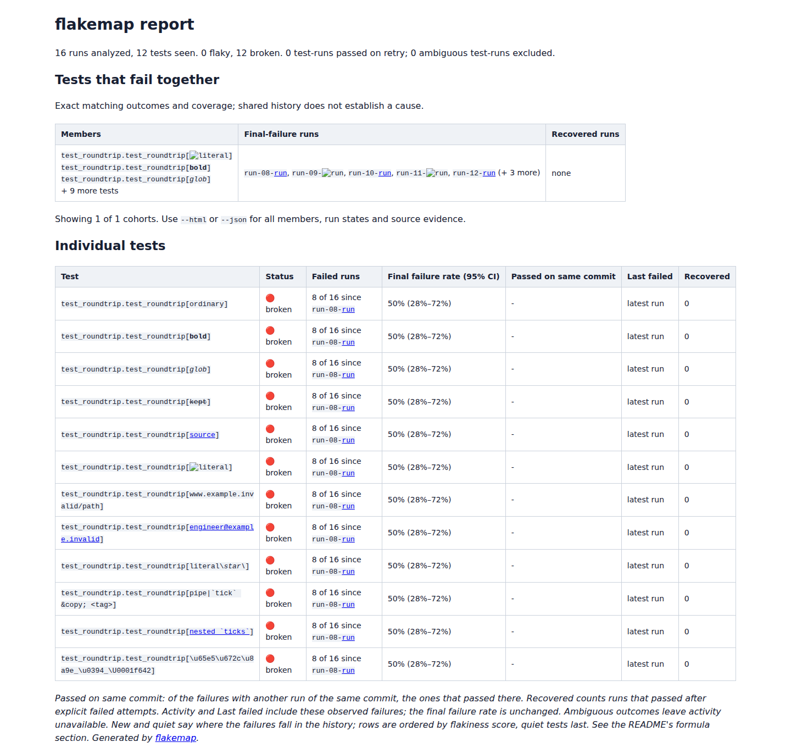
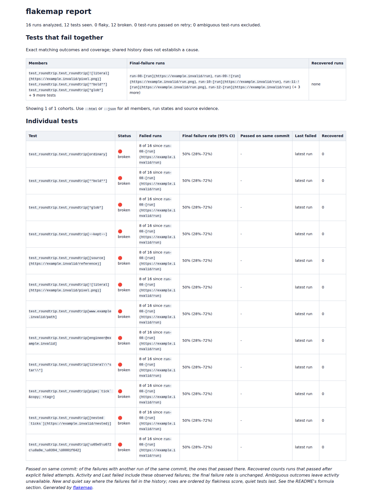
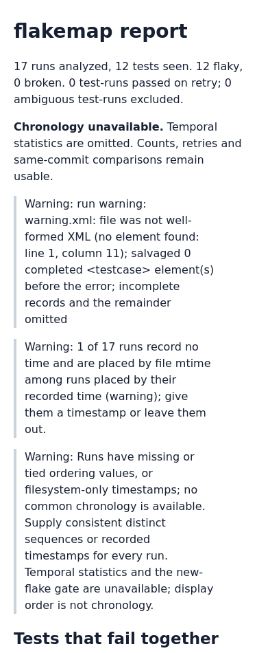
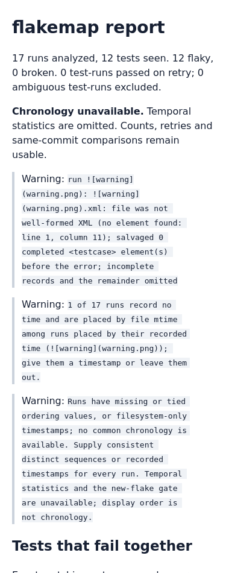

# Test names must stay literal in a Markdown report

Baseline: `b1b2084a89f61a02f70fd9b91069b68fb51fa1b9`. This is source work;
package version 0.3.7 and the hosted demo are unchanged.

The CLI's `--markdown` output wrapped names in HTML `<code>` tags and escaped
HTML, pipes and backticks. GitHub Flavored Markdown still parsed the contents
as images, links, emphasis and strikethrough. A pytest parameter ID containing
`` therefore became an image,
concealing part of the actual test name. Run IDs and warning text were affected
as well. Even entity-encoding punctuation left an email autolink in the reference
renderer.

The fix uses native [GFM code spans](https://github.github.com/gfm/#code-spans)
for imported values. Delimiters are longer than every backtick run in the
value. Padding preserves boundary backticks and spaces; pipes receive the
extra escape consumed by the table parser, while warnings outside tables do
not. Existing visible-control and line-break normalization is preserved.
No parser dependency is added to Flakemap.

## Captured inputs and actual CLI outputs

`producer/test_roundtrip.py` supplies 12 explicit pytest parameter IDs.
`produce.py` runs pytest 9.1.1 on Python 3.12.12 sixteen times: eight controlled
passes followed by eight controlled failures. The retained **192 testcase
records** are actual pytest XML, unchanged after capture. This is a synthetic
history, not evidence of failures in a production project. Run IDs are separately
supplied sidecar metadata. [Capture hashes](capture/capture.json).

`prepare.py` also creates a truncated-file warning variant and a synthetic
Go-style nested-failure control, and copies the existing captured Surefire,
shared-service and GoogleTest histories. Nested Go names intentionally aggregate
to their top-level test; their displayed control remains unchanged.

`capture.py` runs each input through the real CLI for Markdown, JSON plus
standalone HTML, and terminal output. It renders Markdown with the compiled
[cmark-gfm](https://github.com/github/cmark-gfm/tree/27d942c8b0a62d192f616e5bf3578f4b6a89e180)
reference implementation, version `0.29.0.gfm.13`, with table, autolink,
strikethrough and tagfilter extensions. `--unsafe` retains the report's existing
inline HTML. This models GFM parsing, not GitHub's later sanitization or image
proxying.

| Six CLI workflows | Before | Corrected |
| --- | ---: | ---: |
| Inspected fields retaining their complete literal text | 36 of 80 | 80 of 80 |
| Image elements created from imported values | 11 | 0 |
| Links created from imported values | 24 | 0 |

The original project-attribution link remains. The 80 checks include repeated
fields in different report locations; they are not 80 independent inputs.
Names, selected group members, selected failed/recovered run IDs, change-point
run IDs, nested-test labels and warnings are compared with their JSON evidence.
The three captured controls remain correct. All **18 JSON, standalone HTML and
terminal reports** are byte-identical before and after, including statistics,
retry evidence, exclusions and incomplete-input warnings.

[Before receipt](results/before.json), [after receipt](results/after.json),
[original rendered pytest report](rendered/before/pytest/rendered.html),
[corrected rendered pytest report](rendered/after/pytest/rendered.html).
All six Markdown documents and reference HTML outputs are retained under
`rendered/`. A further [52 boundary cases](results/boundaries.json) verify exact
code text for empty values, spaces, backtick runs, backslashes before pipes,
literal entities, HTML and Unicode in paragraph and table contexts.

## Browser replay

Chromium and Firefox load all six actual rendered reports, before and after,
at 1440 and 375 pixels: **48 offline loads**. DOM code text and element counts
match the independent parser. All corrected fields remain literal. Baseline
images attempt **16 requests** across the replay; offline routing blocks them.
The corrected reports attempt none and have no page errors or viewport overflow.
Tables scroll within the local presentation wrapper on narrow screens.

| Pytest report before | Corrected |
| --- | --- |
|  |  |

| Warning on a phone before | Corrected |
| --- | --- |
|  |  |

All four screenshots were inspected. The stylesheet only presents the actual
reference HTML for this study; it is not a GitHub screenshot or a new hosted
report design. [Browser receipt](results/browser.json).

## Reproduce

Build cmark-gfm at the pinned revision above using its documented CMake workflow.
Build or install baseline `b1b2084` separately. From this checkout:

```sh
uv sync --locked
uv run python studies/markdown-literals/prepare.py /tmp/markdown-inputs
uv run python studies/markdown-literals/capture.py /path/to/baseline /tmp/markdown-inputs /path/to/cmark-gfm /tmp/markdown-before
uv run python studies/markdown-literals/capture.py . /tmp/markdown-inputs /path/to/cmark-gfm /tmp/markdown-after --check
uv run python studies/markdown-literals/boundaries.py /path/to/cmark-gfm /tmp/boundaries.json
npm ci
node studies/markdown-literals/browser.mjs /tmp/markdown-before /tmp/markdown-after /tmp/markdown-browser
```

The capture's first argument also accepts an installed environment's Python
executable. Use fresh output directories. To generate a new native pytest capture,
run `uv run python studies/markdown-literals/produce.py /tmp/new-pytest-capture`;
timestamps and durations will differ from the retained capture. Neither pytest
production nor browser verification sends requests to the example URLs.
