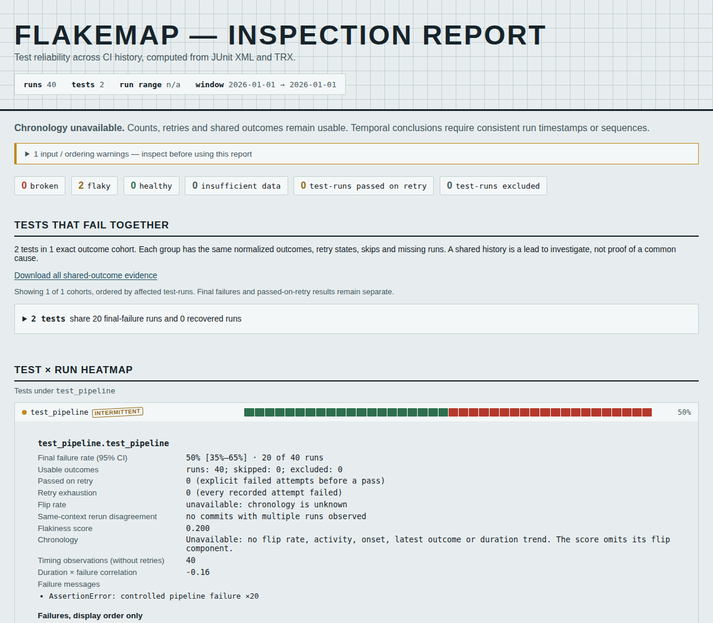

# Folder names cannot establish a regression

The same 40 reports, with the same 20 passing and 20 failing executions, produced
three different temporal stories at source revision `a423cad`. All sidecar times
were tied. Lexical folder order became the purported timeline anyway.

This directory retains **actual pytest 9.1.1 output from controlled tests**, not
production failures. `capture.py` runs the two tests in `project/` 40 times. Their
failure condition deliberately changes after index 19. The XML is unedited;
sidecar timestamps are deliberately replaced with the same synthetic instant to
model lost/coarse ordering metadata. `capture-manifest.json` records the actual
pytest exit codes. Every replay verifies the original report bytes by SHA-256.

| Layout / metadata | Before | Corrected |
|---|---|---|
| Passes sort before failures; tied timestamps | Broken; regression at run-20; new-flake gate 1 | Chronology unavailable; gate 2 |
| Failures sort before passes; same evidence | Flaky; apparent recovery at run-20; gate 1 | Chronology unavailable; gate 2 |
| Pass/fail alternate by folder name | Flaky; 100% flip rate; gate 0 | Chronology unavailable; gate 2 |
| Complete sequence establishes pass-to-fail order | Broken; regression at run-20; gate 1 | Same regression; gate 1 |
| Complete sequence establishes fail-to-pass order | Recovery still trips new-flake gate, exit 1 | Recovery retained; gate 0 |

The corrected unordered reports retain both tests' 50% failure rates and their
exact shared-outcome cohort. They withhold activity, change points, flips, latest
outcome and duration trend. Classification uses the remaining aggregate evidence;
"flaky" is a heuristic over the supplied observations, not proof of randomness or
of the current state. The score omits the unavailable flip contribution.



`before.json` and `after.json` contain the measured CLI exits, selected statistics,
and hashes of all 80 input XML/metadata files. The scripts are reproducible without
running Kubernetes code or calling a CI service:

```sh
uv sync --locked --all-extras
uv run python studies/ordering-evidence/verify.py --check --out scratch/ordering-browser
node scripts/check_report.mjs scratch/ordering-browser
```

`verify.py` copies the retained reports into temporary folder permutations and
invokes both the library and installed CLI. To regenerate the original pytest
executions, run `uv run python studies/ordering-evidence/capture.py`; this changes
real timestamps and measured durations, so it intentionally changes input hashes.
Capture subprocesses receive only the two study environment variables.

The JSON contract is version 3: some formerly required temporal values can now
be null. See [the migration and ordering contract](../../docs/formats.md#json-output-version-3).
Complete unique sequences can disambiguate tied times, but sequence and recorded
time cannot contradict one another. File mtimes supply display order only.

## Scope

This does not reconstruct missing chronology, determine a causal regression,
or certify that every CI artifact was collected. A single unplaced run can make
the whole supplied timeline unavailable; counts and inspectable outcomes survive.
Provide actual ordering metadata or analyze an explicitly selected, ordered cohort.
The new-flake gate cannot safely treat unavailable recency as a clean result.

These are local source changes. No package release, remote push or deployment is
part of this work. Historical study JSON/HTML retains its original schema and
recorded claims; regenerating it uses the current ordering contract.

## Previously captured Kubernetes histories

The audit re-read the cached public study, checking **10,774 XML files** against
the sizes and MD5 values in the committed Kubernetes manifest before analysis.
Both the baseline and corrected implementations read **4,315 runs**: 2,162
integration builds and 2,153 unit builds. Every compared per-test statistic was
unchanged across 136 integration and 1,524 unit test identities. Both histories
have complete distinct recorded timestamps; one integration build obtains its
time from the report rather than a sidecar.

`corpus-integration.json` and `corpus-unit.json` retain the compared fields and
SHA-256 of the complete per-test comparison data. To repeat, run `audit.py` in
both package environments, then compare the outputs:

```sh
uv run python studies/ordering-evidence/audit.py \
  --cache studies/kubernetes-ci/cache --manifest studies/kubernetes-ci/manifest.json \
  --job ci-kubernetes-unit > scratch/unit-after.json
python studies/ordering-evidence/compare_audits.py scratch/unit-before.json scratch/unit-after.json
```

The cache is not committed; obtaining it is described in the
[Kubernetes study](../kubernetes-ci/README.md). This is a regression replay of
previously captured public evidence, not a new census or a rerun of Kubernetes.
