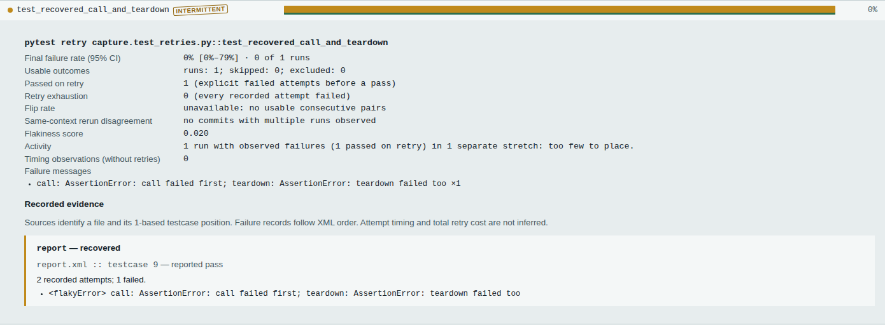
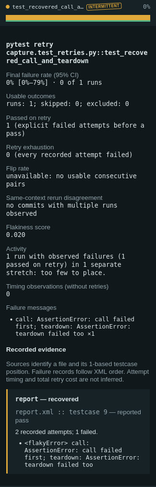

# Capture pytest retries while their phase evidence exists

The ordinary native JUnit export contains repeated testcase names without
their intermediate failure details. Flakemap already excludes those ambiguous
records. This change adds an opt-in producer so a Python CI workflow can retain
the evidence instead of trying to infer retries after export.

The [usage guide](../../docs/pytest-capture.md) documents installation, paths,
gates, identity conventions and capture limits.

## Actual producer replay

[The controlled test file](native/test_retries.py) contains passing, recovered,
exhausted, setup, teardown, simultaneous call/teardown, skip, xfail, xpass and
parameter-name cases. These are authored deterministic failures executed by
real pytest, not measurements of production test reliability.

The [replay](replay.py) launches the installed package from outside the source
tree, with and without the companion plugin, in serial and with two xdist
workers. An independent fixture writes each actual attempt to a separate ledger;
the reporter does not read it. The replay compares those side effects, ordinary
JUnit outcomes and native XML markers before checking CLI reports and gates.

| Recorded quantity, per replay | Result |
|---|---:|
| Logical tests | 15 |
| Ordinary JUnit testcase elements | 31 |
| Ordinary JUnit declared tests | 19 |
| Companion testcase elements | 15 |
| Actual fixture executions in the independent ledger | 29 |
| Recovered tests | 4 |
| Exhausted tests | 5 |
| Explicit failed attempts | 20 |
| Ordinary input `--fail-on-incomplete` exit | 2 |
| Companion input `--fail-on-incomplete` exit | 0 |
| Companion input `--fail-on-retry` exit | 1 |

The marked setup skip does not execute the ledger fixture. The xfail does, then
remains a skipped result. Strict xpass is retried and fails. Thus 29 ledger
entries are execution side effects, not a claim of 29 independent test samples.
Both producers have identical ordinary outcomes and actual execution ledgers;
the companion reports four recovered histories without changing the runner.

[Raw serial inputs and CLI results](captured/serial),
[two-worker inputs and results](captured/parallel),
[working replay receipt](results/working.json), and
[minimum-version installed-wheel receipt](results/minimum.json) retain the
measurements. Each input is unchanged producer XML; the execution ledger is
written separately by the fixture.

To reproduce with a wheel installed in a separate environment:

```sh
uv build
uv venv --python 3.12 /tmp/flakemap-capture-venv
uv pip install --python /tmp/flakemap-capture-venv/bin/python \
  dist/flakemap-0.3.7-py3-none-any.whl -r studies/pytest-capture/requirements.txt
python studies/pytest-capture/replay.py /tmp/flakemap-capture-venv/bin/python \
  /tmp/flakemap-capture-replay
```

Choose a new or empty output directory. The replay retains raw XML, independently
written ledgers, ordinary before/after output, CLI JSON, an offline HTML report,
and package/runtime hashes. It asserts actual exit codes and compares all
ordinary outcome markers and messages, excluding measured times and clocks.

## Installed package and visible evidence

The [installed-wheel replay](results/installed.json) repeats both producer modes
with Python 3.12. The [runtime inventory](results/installed-files.json) compares
all 33 source files with the built wheel and installed files, and checks that no
pytest plugin is automatically registered. The extra supplies pytest only when
requested; the user explicitly loads the reporter.

[Complete serial](results/complete-installed-serial.json) and
[parallel](results/complete-installed-parallel.json) analyses match the retained
replay after excluding only recorded clocks and durations. The
[minimum serial](results/complete-minimum-serial.json) and
[parallel](results/complete-minimum-parallel.json) results also match.
[The comparison](compare.py) retains every outcome, message, statistical result,
source ordinal and gate-relevant field. This check caught the initial xdist
strict-xpass message extraction: it showed a worker header instead of the
original outcome reason. String and skip-tuple reasons now survive serialization.

The [browser replay](results/browser.json) checks the standalone example in
Chromium and Firefox at 375/1440 px, light and dark. All eight cases open evidence
with the keyboard and download complete matching JSON and an archive containing
the original XML while offline: 16 actual downloads, no page errors or horizontal
overflow. Full-page and evidence screenshots were inspected; the clean replay's
16 images match the reviewed prior captures byte for byte.





## Boundaries

The capture makes no changes to pytest scheduling or exit status. Attempts do
not become extra runs, recoveries are not final failures, and a passing retry
does not establish future reliability. The existing single-run uncertainty stays
wide. XML properties retain measured phase durations; retry delays and unseen
wall time are not reconstructed.

Native regression scenarios also cover a killed process replacing stale success,
collection failure, early stop, retry ending in a skip, and pytest's existing
flaky gate. Subtests and unsupported report protocols remain unknown. Source,
installed artifacts, gallery pages and a registry release are separate claims.

An additional [controlled worker termination](native/test_crash.py) ran under
two xdist workers with restarts disabled. The [raw capture](captured/worker-crash/capture.xml)
and [CLI analysis](captured/worker-crash/analysis.json) retain the completed pass,
exclude the interrupted test and identify the incomplete capture. Pytest exits
1; `--fail-on-incomplete` exits 2. This control deliberately terminates a worker;
it is separate from the 15-test retry example.

The producer uses pytest's documented
[phase report hook](https://docs.pytest.org/en/stable/reference/reference.html#pytest.hookspec.pytest_runtest_logreport)
and the explicit retry indices emitted by
[pytest-rerunfailures](https://github.com/pytest-dev/pytest-rerunfailures).
It does not identify retry relationships from filenames or adjacent XML records.

## Published example and source installation

[Open the captured pytest report](https://antonsoo.github.io/flakemap/pytest.html).
The [clean verification](results/verification.json) retains 438 passing cases on
Python 3.12 and again on Python 3.10 with minimum direct dependencies, plus 160
offline report scenarios across both browser engines and themes. These checks
are separate from the native producer replay and actual download workflows.

[The public source install](results/public-install.json) replaces registry 0.3.7
with pinned revision `bb6a48e`, verifies all 33 installed runtime files, and then
[repeats the native replay](results/public-install-replay.json). Both complete
[serial](results/complete-public-serial.json) and
[parallel](results/complete-public-parallel.json) analyses match, retaining
messages and excluding only the recorded time fields. The registry 0.3.7 package
tested before upgrade has no companion reporter.

Pages `1e3c9a6` serves the reviewed 18-file build plus its existing `.nojekyll`
marker. [All 19 canonical files](results/hosted-bytes.json) match. The
[branch comparison](results/pages-diff.json) retains every earlier file: seven
HTML navigation bars change, nine existing files remain byte-identical, and
three pytest files are added. [Public browser replay](results/hosted-browser.json)
enters from the home page with Enter, opens evidence and makes 16 matching offline
downloads. Its 16 screenshots match the reviewed clean captures byte for byte.
The [publication receipt](results/publication.json) separates these observations
from a registry release or a hosted workbench update.
