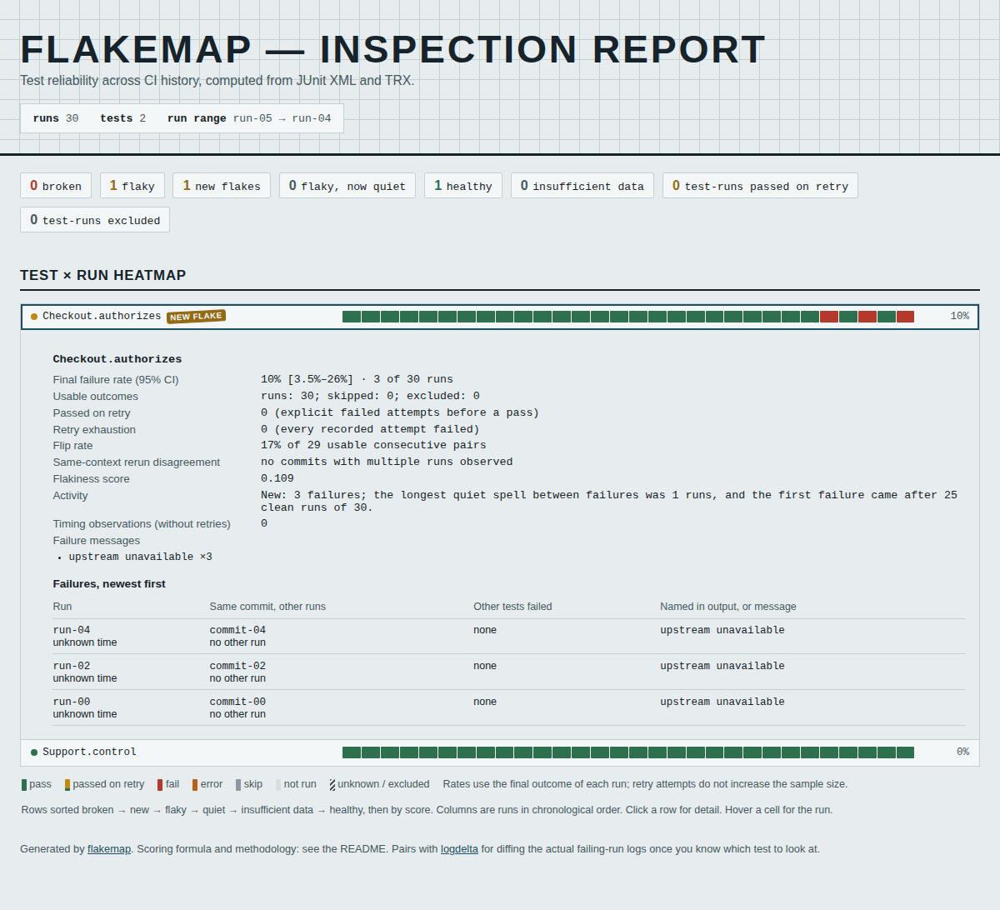
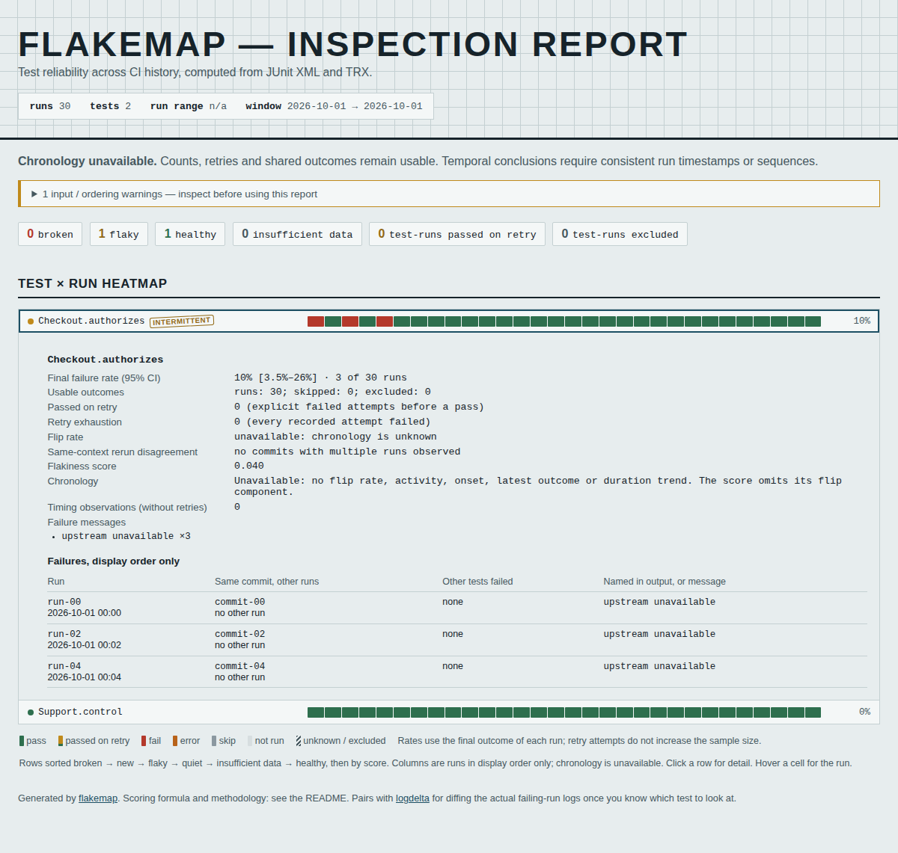

# A sequence must not erase a report's recorded time

At baseline `02cb6e0`, adding sequence-only metadata alongside a timestamped
JUnit or TRX report erased the report's timestamp. A sequence that contradicted
the recorded run times was then accepted as chronology. In a controlled
30-run history, that moved three old failures behind 25 passes, labeled them
`new`, and returned exit 1 from `--fail-on-new-flake`.

Moving exactly the same metadata to a sibling report in the same run retained
the timestamp and returned exit 2 for unavailable chronology. Where a sidecar
was stored therefore changed the temporal conclusion.

```text
Recorded runs:    F P F P F | P P P ... P  (25 later passes)
Bad sequence:    P P P ... P | F P F P F

Before: discard report times -> accept sequence -> NEW FLAKE, exit 1
After:  retain report times  -> detect conflict -> chronology unavailable, exit 2
```

The correction keeps report timestamps and their `report` provenance when a
sidecar provides a sequence without a timestamp. Ordering can then check both
recorded keys. A sidecar's explicit timestamp still takes precedence. All
30 outcomes, including 27 passes and three failures, remain available; the
repair does not choose which contradictory ordering key was correct.





## Actual CLI reproduction

The [before receipt](results/before.json) and [after receipt](results/after.json)
run **2 report formats x 3 sidecar locations x 3 metadata profiles = 18 cases**
through the actual CLI, writing JSON and standalone HTML. Inputs are synthetic
histories, not collected CI runs. Their known instants are one minute apart;
filesystem times are controlled and point in the opposite direction.

| Metadata profile | Same-report or run-directory sidecar, before | Sibling-report sidecar, before | After, all locations |
|---|---|---|---|
| Contradictory sequence; no sidecar time | False new-flake alert, exit 1 | Unavailable chronology, exit 2 | Unavailable chronology, exit 2 |
| Consistent sequence; no sidecar time | Quiet failures, exit 0; report time lost | Quiet failures, exit 0 | Quiet failures, exit 0; report time retained |
| Explicit sidecar time consistent with its sequence | New-flake alert, exit 1 | New-flake alert, exit 1 | New-flake alert, exit 1 |

The third profile deliberately supplies a different explicit timestamp. It
checks the documented authority of sidecar times over report starts, rather
than asking the loader to resolve external clock errors. Both formats give
the same decisions. Four baseline gate decisions are wrong across the 18
cases; the correction resolves all four and preserves the valid controls.

```sh
uv sync --locked
uv run python studies/report-sequences/capture.py --check
uv run pytest -q tests/test_report_sequences.py
```

Use `--source /path/to/checkout` and omit `--check` to replay the baseline.
Use `--python /path/to/installed/environment/bin/python` without `--source`
to exercise a wheel. `--artifacts /tmp/report-sequences` retains every HTML
report. The receipts retain gate decisions, source provenance, timestamp
coverage, outcome counts, warnings and input/output hashes.

## Boundaries

This repair retains existing evidence; it does not infer timestamps from file
names, manufacture a time for a sequence, resolve inconsistent clocks or
authenticate supplied metadata. Offset-free report times retain their existing
handling. When recorded ordering keys contradict, temporal conclusions are
unavailable while count-based analysis remains usable. Exit 2 is a request for
consistent metadata, not a passing gate.

This is a local source correction, with no package publication or hosted update.

## Clean installation and visible reports

The [verification receipt](results/verification.json) records a clean archive
of implementation commit `fb10ab6`: all 932 archived files remain unchanged
after a locked Python 3.14.7 install, lint, formatting, strict type checking,
**376 passing tests**, and an sdist/wheel build. The wheel's 30 Python library
files match source and both isolated installations byte for byte.

| Installed wheel | Full suite | CLI cases | HTML reports matching source |
|---|---|---|---|
| Python 3.14.7, Rich 15.0.0 | 376 passed | 18 passed | 18 of 18 |
| Python 3.10.21, minimum Rich 13.7.0 | 376 passed | 18 passed | 18 of 18 |

[Current](results/installed.json) and [minimum](results/minimum.json) receipts
retain the gate decisions and unchanged input hashes. The isolated Python
processes import the wheel from their environments, with no source path.

[32 offline browser checks](results/browser.json) inspect the before/after
reports in Chromium and Firefox at 1200px and 375px. Contexts are offline before
their first navigation. The checks open failure evidence by keyboard, retain
all 27 pass and three fail cells, check chronology labels and detect page
overflow, script errors and remote requests. The loaded after-report bytes
match the installed wheel's HTML exactly. Both screenshots above were visually
inspected; their counts, timestamps and warning are readable.

```sh
npm ci
node studies/report-sequences/browser.mjs /tmp/before-html /tmp/after-html
```

Generate those directories with the capture script's `--artifacts` option
against the two versions. These are standalone report checks; there is no new
hosted build or deployment.
