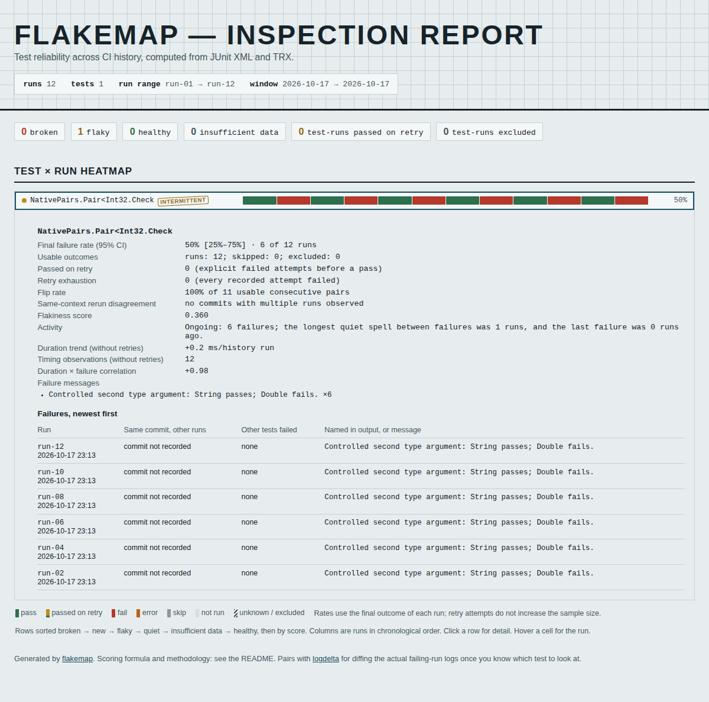
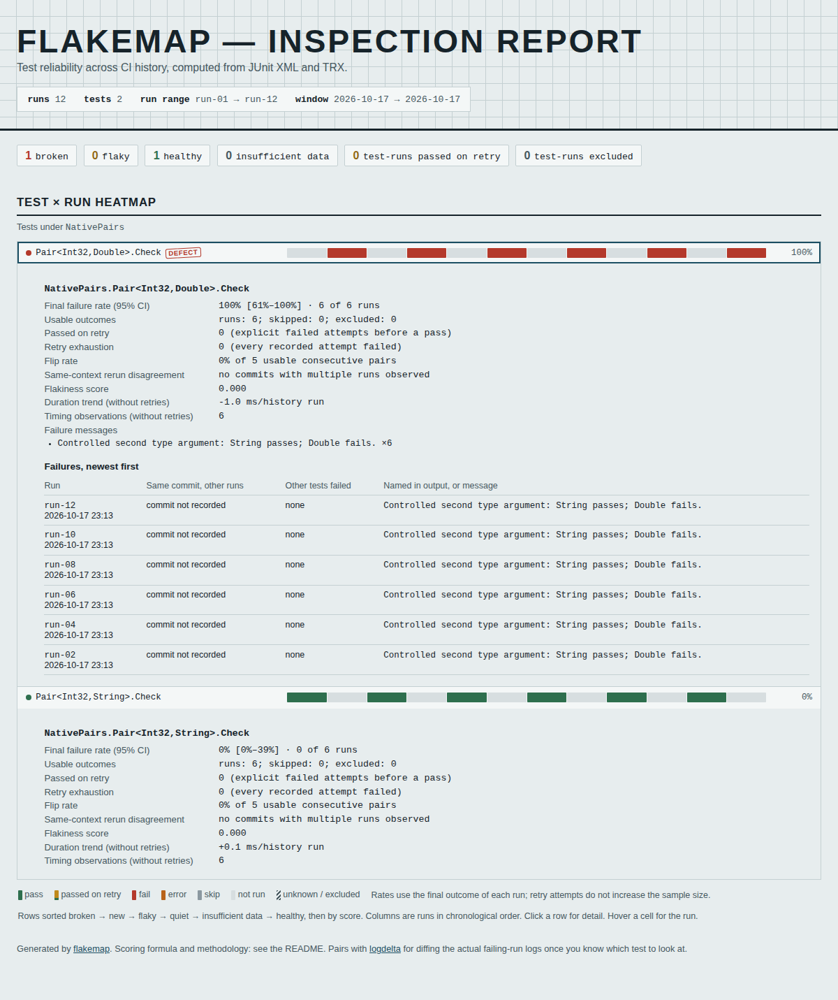

# Two closed fixtures are two tests

NUnit emits `NativePairs.Pair<Int32,String>` and
`NativePairs.Pair<Int32,Double>` as distinct classes in its native TRX file.
Flakemap formerly treated the first comma as an assembly separator and shortened
both to `NativePairs.Pair<Int32`.

In the [compiled controlled capture](native/FixtureIdentity.cs), the String
fixture always passes and Double always fails. Twelve selected native runs
alternate them. The former CLI reports **one 50% flaky test**. The corrected CLI
reports **two separate histories**, six passes and six failures respectively.
These are authored constant outcomes, not evidence about production test flakiness.

| Input | Former report | Corrected report |
|---|---|---|
| Twelve selected native runs | One flaky test, 6/12 failures | String: 0/6, healthy; Double: 6/6, broken |
| One native run of all four fixtures | Generic pair excluded as ambiguous | Four distinct observed outcomes, no exclusion |
| Ordinary and single-argument fixtures | Retained | Unchanged |

[Before CLI output](before/replay.json) and [after CLI output](after/replay.json)
retain complete JSON and actual standalone HTML reports. The same-run case's
`--fail-on-incomplete` exit changes from 2 to 0 because the two recorded
identities are no longer collapsed; its known failed execution remains a failure.

## Native evidence and limits

The capture executes actual compiled NUnit 3.14.0 tests with adapter 4.6.0,
Microsoft.NET.Test.Sdk 17.11.1 and .NET SDK 8.0.425. Thirteen TRX reports contain
16 executions: 12 selected fixture runs plus one combined four-fixture run.
The [manifest](native-capture/capture.json) records each native class name,
outcome, process exit and raw/retained checksum. Only local paths and machine
identifiers are normalized. Test names, class names, outcomes, counters and
recorded start times remain unchanged. Expected native failure exits are checked.

The correction scans delimiters before removing an assembly qualifier. Angle
and square brackets, array ranks and escaped commas retain their literal
contents. Unfamiliar unbalanced names remain literal. This is a bounded lexical
split, not a type resolver or a new canonicalization between different naming
styles. Genuine duplicate identifiers remain unknown.

[Microsoft's type-name grammar](https://learn.microsoft.com/en-us/dotnet/fundamentals/reflection/specifying-fully-qualified-type-names)
distinguishes generic-argument/array commas and escaped identifiers from an
assembly qualifier. The native NUnit reports above establish the observed
angle-bracket spelling independently of that CLR grammar.

Complete JSON output for [ten existing captured histories](controls.json),
covering 62 test identities, is byte-identical after canonical JSON serialization.
This includes the original MSTest, pytest, Surefire, GoogleTest, incomplete-input
and TRX hierarchy/counter controls. Classifier formulas and rate definitions
are unchanged.

## Replay

The committed native reports need no .NET installation:

```bash
uv run flakemap studies/trx-generics/native-capture/history --html generic-history.html
uv run flakemap studies/trx-generics/native-capture/combined --json --fail-on-incomplete
```

To regenerate the controlled execution, use a .NET 8 SDK and run
`uv run python studies/trx-generics/capture.py --output /tmp/new-generic-capture`.
The output directory must be new; `--dotnet PATH` selects the SDK. It restores
the pinned NUnit/adapter/test-SDK packages. `replay.py --python PYTHON --output DIR
--phase after` checks an actual installed CLI against identities read independently
from XML, and writes its JSON/HTML. `controls.py` retains complete JSON checksums
for the unaffected inputs; `--source CHECKOUT` can select an older parser.

The example gallery includes **Distinct generic fixtures**, an offline JSON
analysis download and an archive of the 12 native TRX inputs. The archive keeps
those exact report bytes so the CLI can reproduce the displayed result without
NUnit or a network connection.

## Read the actual report





[Before browser receipt](before/browser.json) and [after receipt](after/browser.json)
cover both actual CLI files in Chromium and Firefox at 1200 and 375px, offline.
Keyboard disclosure reveals complete literal type names; JSON and displayed
outcomes agree. All 16 captured screenshots were reviewed. Errors, extra HTTP,
CSP violations, accessibility violations and page overflow are absent.

The [local gallery receipt](local-gallery-browser.json) covers all six pages in
24 real browser views. Its four actual offline native-input archive downloads
retain all 12 original TRX byte sequences; an independently installed wheel
reproduces the complete displayed JSON: [download replay](local-downloads.json).

The [local wheel receipt](package-verification.json) distinguishes the verified
runtime artifact from PyPI's separately downloaded 0.3.7 wheel, which still
contains the former first-comma split. This correction adds no runtime dependency
and makes no package release. The separate hosted workbench is outside this check.

## Verified source and public gallery

[Clean archive verification](verification.json) records source `401dc15`, fresh
Python 3.12.12/Node 24.21.0 installs, lint/format/type checking, 412 unit checks,
wheel/sdist builds and all 136 browser scenarios across eight engine/width/theme
contexts. Each context completed with process exit 0. An earlier long browser
attempt ended with exit 143 and was not accepted as a pass. Python 3.10.21 with
Rich 13.7.0 also passes all 412 checks; its installed wheel reproduces both
native cases. The rebuilt wheel is byte-identical to the tested artifact.

The README's [pinned public source installation](public-source-install.json)
was executed using pip in a fresh environment and reproduces both cases. All
30 installed runtime modules match the clean source bytes.

Pages `43f6522` serves that build. All 12 built files and the canonical root
match exactly: [public HTTP bytes](hosted-bytes.json). Twenty-four
[public browser views](hosted/browser.json) repeat the offline disclosure and
download workflows. Twenty JSON downloads match their complete analyses. Four
actual native-input archives retain all 12 original reports and reproduce the
complete gallery JSON through the installed wheel:
[public archive replay](hosted-downloads.json).

All 12 public screenshots are byte-identical to the reviewed local gallery
captures. [Publication receipt](publication.json) separates the precomputed
hosted report from native browser ingestion, PyPI and the separate workbench.
