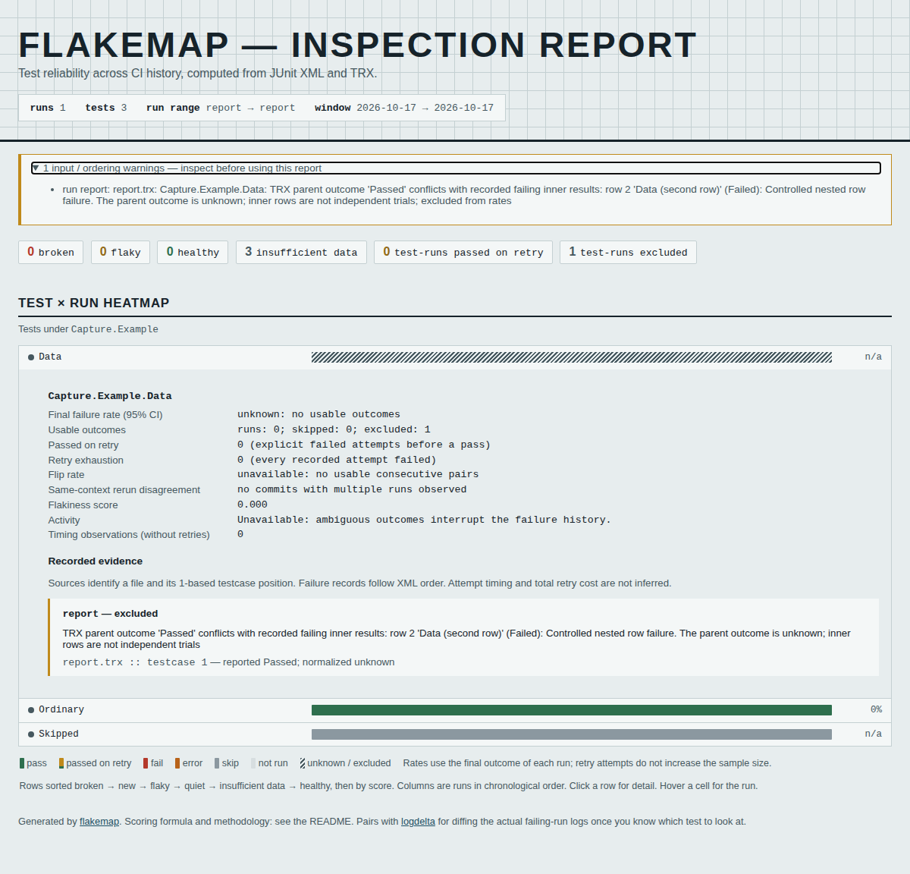

# A passed TRX parent can still contain a failed row

At source baseline `b7667d7af6701cde62afb305c1b2e6eb98bf7c52`, the retained
VSTest file has a `Passed` data-driven parent, a `Failed` inner row, a failed
run summary and matching primary counters. Flakemap nevertheless reports one
passing parent observation and exits 0 with `--fail-on-incomplete`. The failed
child's name and message disappear from its analysis.

The current source excludes that aggregate as unknown, retains its original
declaration and child evidence, and exits 2 with the completeness gate. It does
not invent a parent failure or count the children as extra statistical trials.



The [baseline capture](../../docs/assets/trx-hierarchy/before/chromium-1200.png)
shows the same native file with a green cell and a zero final-failure estimate.

## Native evidence and scope

[Program.cs](native/Program.cs) sends authored public `TestResult` events through
the actual logger shipped with .NET SDK 8.0.425, informational logger version
17.11.1-release-24455-02. This is a real logger capture, **not** a test adapter,
application test execution, or evidence of production incidence. The SDK keeps
the supplied parent and child outcomes; this is not a claim of a VSTest defect.

The [seven retained files](fixtures/), [capture manifest](native/capture.json)
and [capture tool](capture.py) preserve the outcomes, hierarchy, counters and
recorded times. Machine/deployment names are removed, the run's display name is
replaced, and XML is reserialized. The manifest retains raw and retained hashes.

| Native control | Previous parent | Current parent | Completeness gate, before / after |
| --- | --- | --- | --- |
| Passed parent, failed child | Pass | Unknown | 0 / 2 |
| Skipped parent, failed child | Skip | Unknown | 0 / 2 |
| Failed parent, failed child | Fail | Fail | 0 / 0 |
| Failed parent, all children pass | Fail | Fail | 0 / 0 |
| Passed parent, passing children | Pass | Pass | 0 / 0 |
| Passed parent, passing/skipped children | Pass | Pass | 0 / 0 |
| Grandchild events written as top-level results | Pass, plus separate failed leaf | Same | 0 / 0 |

Exit 0 here means the **completeness** gate accepts the evidence; it does not
mean all tests passed. On the first file, the native primary counters are
`total=5 executed=4 passed=3 failed=1`. All five result records are present.
Counter reconciliation alone cannot establish a usable aggregate observation.

```text
Top-level records (shown by name)
+- Data: reported Passed -> normalized Unknown
|  +- child 1: Passed
|  `- child 2: Failed
+- Ordinary: Passed
`- Skipped: NotExecuted
```

The last control records a useful producer boundary. This SDK writes the
grandchild events as additional top-level results, without their event-parent
links. The parser preserves that recorded structure. A deeper nested XML tree
is tested with an explicitly authored transformation; it is not presented as
another native logger capture.

The independent [oracle](oracle.py) imports no Flakemap code. It checks the
native XML, all-result counter convention of this logger version, preserved
source hashes, parent trial counts and retained child paths against actual CLI
outputs. All seven counter sets reconcile. [Before](results/before.json) and
[after](results/after.json) retain process exits and full analyses. The five
consistent controls have byte-equivalent JSON analyses; unrelated tests in the
two changed files also retain their statistics. The existing
[21 counter replays](results/counter-compatibility.json), including twelve
actual MSTest reports, preserve all input counts, gates and test statistics.

The SDK source identifies the
[public result handler](https://github.com/microsoft/vstest/blob/v17.11.1/src/Microsoft.TestPlatform.Extensions.TrxLogger/TrxLogger.cs)
and its result/counter updates. No SDK assemblies are vendored here; the capture
project references the selected SDK's own logger and object-model assemblies.

## Policy and report contract

Flakemap's existing rate model keeps one observation per top-level test and
run. A known failed descendant under a reported passed/skipped parent cannot
establish a coherent successful aggregate for that observation. Unknown is a
review state under this contract, not a claim that the source file is malformed.
A parent may describe its own work or an adapter may have different aggregation
semantics; this reader does not infer their cause or synthesize a new verdict.

Already-failed parents remain failed, including when all recorded children pass.
An unsupported parent outcome retains its original unknown reason. Unknown
child outcomes, missing child identity, invalid recorded durations and unsupported
inner elements warn about unverified coverage. Missing duration stays missing.
Child statuses only map reported vocabulary; they never become independent
trials, retries, or evidence of an inferred parent result.

`TestCaseResult.nested_results` retains the raw `reported_parent_outcome` and
child `rows`, each with its path, name, reported outcome, mapped status, reported
duration and message. Paths are one-based recognized result ordinals in XML
preorder: `[1, 2]` means the first inner result's second inner result. They are
not source line numbers. Excluded record JSON retains these facts; HTML shows
bounded failing-row previews and identifies reported versus normalized outcomes.
The parser's source-specific exclusion warning is kept once during analysis.
Normalizations without a parser warning still produce their own warning.

Native file reads remain subject to the existing 64 MiB, 250,000-element and
256-level XML limits. Traversal is iterative; metadata are not flattened into
more trials. Warning previews are bounded while record evidence keeps all
recognized children. This does not validate every TRX semantic convention,
authenticate a producer, or recover relationships omitted by the writer.

## Reproduce

```sh
uv sync --locked
uv run python studies/trx-hierarchy/replay.py --output scratch/trx-hierarchy --check
node studies/trx-hierarchy/browser.mjs scratch/trx-hierarchy scratch/trx-hierarchy-browser
```

The browser check needs `npm ci` and cached Chromium/Firefox. It opens actual
CLI-generated files directly, offline, checks keyboard disclosures, source
labels, unknown cells, page width, accessibility, page errors and CSP. The
source before/after runs each cover 56 views: seven files, two engines, two
widths and two themes. Four baseline and four corrected screenshots were
visually inspected. This changes the existing report's evidence, not its layout.

To author new native captures, select a .NET 8 SDK with the logger assemblies:

```sh
uv run python studies/trx-hierarchy/capture.py --output scratch/new-trx-capture
```

The output directory must be fresh. `--dotnet /path/to/dotnet` selects an SDK;
the manifest records its actual version. A later SDK may serialize hierarchy or
counters differently. The committed fixtures require no SDK to replay.

## Retention cost

[performance.py](performance.py) constructs 10,000 children from retained native
record shapes, with one failing child under a passed parent. It does **not** run
10,000 application tests or claim that a real adapter produced this family.
The 5,263,070-byte input has the same hash in both runs. The corrected CLI keeps
three top-level tests, excludes the parent, and retains all 10,000 children in
record JSON. The older CLI kept a passing parent and no child evidence.

[Before](results/performance-before.json) and [after](results/performance-after.json)
record GNU time's actual CLI wall time and peak RSS, input/output hashes and
machine information. Retaining evidence increases the JSON output from about
5.6 KB to 3.5 MB. These are individual local observations, not worst-case time,
memory, or output-size guarantees. The study tool can be rerun with:

```sh
uv run python studies/trx-hierarchy/performance.py --output scratch/trx-retention-cost
```

Source, installed artifacts and public installation evidence are recorded at
their verified revisions. No registry release or static-demo deployment follows
automatically from this parser correction.

## Exact Wilson endpoints in the report

Visual review also found a zero-failure interval printed with a long tiny
positive lower bound. The floating-point result could exclude its own zero
point estimate. The source now uses the analytic endpoints: zero for 0/n and
one for n/n. Interior formulas retain their precision, including small
nonzero bounds. The [74-case independent comparison](results/wilson-boundaries.json)
with SciPy 1.18.1 records ten containment violations before and none after,
with maximum absolute reference error of about 1.1e-16. SciPy documents its
[uncorrected Wilson method](https://docs.scipy.org/doc/scipy/reference/generated/scipy.stats._result_classes.BinomTestResult.proportion_ci.html).

## Clean source and installed artifacts

The [verification receipt](results/verification.json) records the clean archive
at `0fa4d5eb2bb1aba53920aa618e712644fff0ddb4`, including the Wilson correction.
Both Python 3.14.7 and the minimum Python 3.10.21 environment passed all 402
tests, with no skips. The latter used the minimum Rich 13.7.0. Ruff, format
checks and mypy also passed. The independent native oracle was repeated against
this source; all 21 earlier TRX counter replays remain identical.

The built wheel and sdist, then fresh runtime-only installations of each,
matched all 30 package source files. The wheel used Python 3.14.7 / Rich 15.0.0;
the sdist used Python 3.10.21 / Rich 13.7.0. Both installed CLIs reproduced all
seven analyses and completeness exits. [Artifact hashes and installation receipt](results/artifacts.json).
The version remains 0.3.7; these locally built artifacts are not a PyPI release.

The [full report browser replay](results/report-browser.json) passed 112 offline
scenarios in Chromium and Firefox at 320 and 1200 pixels, light and dark,
including the existing five-page gallery. All 48 generated full-report captures
were visually inspected. The installed wheel's native reports passed another
[56 offline views](../../docs/assets/trx-hierarchy/installed/browser.json) at
375 and 1200 pixels. Its four [captures](../../docs/assets/trx-hierarchy/installed/)
were inspected alongside the eight before/source captures. These checks found
no page errors, external requests, CSP violations, accessibility violations or
page overflow. The report layout is unchanged; native contradictions now have
an unknown cell, an unavailable rate, their source declaration and one warning.
